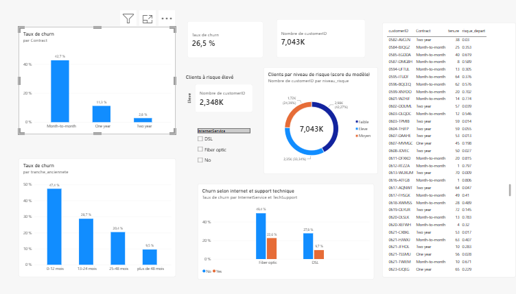

# Prédiction du churn client télécom

Projet personnel d'analyse de données : comprendre pourquoi les clients d'un opérateur télécom résilient leur abonnement, et prédire ceux qui risquent de partir.

## Objectif

Identifier les profils de clients qui quittent l'opérateur et classer les clients selon leur risque de départ, afin que l'équipe commerciale puisse agir en priorité sur les plus exposés.

## Données

- Jeu de données **Telco Customer Churn** (IBM Sample Data Sets), disponible sur Kaggle : https://www.kaggle.com/datasets/blastchar/telco-customer-churn
- 7 043 clients, 21 colonnes d'origine. 26,5 % de clients partis (1 869).
- Les données ne sont pas incluses dans ce dépôt : télécharge le fichier CSV depuis Kaggle et place-le dans `data/`.

## Outils

Python (pandas, numpy, scipy, scikit-learn, matplotlib), SQL (SQLite), Power BI Desktop, Git.

## Démarche

1. **Nettoyage (pandas)** : `TotalCharges` était lu comme du texte. 11 valeurs vides, toutes avec `tenure = 0` (clients inscrits ce mois-ci), remplacées par 0. Aucun doublon.
2. **Analyse SQL** : requêtes dans `sql/01_analyse_churn.sql`.
3. **Statistiques** : tests du khi-deux entre le churn et plusieurs variables.
4. **Modèle** : régression logistique et random forest (scikit-learn), évalués sur 20 % de clients non vus à l'entraînement.
5. **Tableau de bord Power BI** : taux de churn par contrat, ancienneté, internet et support technique, niveaux de risque.

## Résultats

**Analyse SQL**

| Contrat | Taux de churn |
|---|---|
| Mensuel | 42,7 % |
| 1 an | 11,3 % |
| 2 ans | 2,8 % |

- Le contrat mensuel concentre 1 655 des 1 869 départs (environ 89 %).
- Clients de 0 à 12 mois d'ancienneté : 47,4 % de churn, contre 9,5 % après 48 mois. La première année concentre environ 55 % des départs.
- Fibre optique sans support technique : 49,4 % de churn, contre 22,6 % avec support.

**Tests du khi-deux** : contrat, type d'internet, support technique et moyen de paiement sont significativement liés au churn (p < 0,001). Le genre ne l'est pas (p = 0,49).

**Modèle** (jeu de test : 1 409 clients, classe « client parti »)

| Modèle | Precision | Recall | F1 | ROC-AUC |
|---|---|---|---|---|
| Régression logistique | 0,50 | 0,78 | 0,61 | 0,842 |
| Random forest | 0,54 | 0,77 | 0,63 | 0,842 |

Les deux modèles ont des performances comparables. La régression logistique est retenue comme modèle principal car elle est interprétable. Elle associe un risque plus élevé aux clients en contrat mensuel, avec fibre optique et peu d'ancienneté, et un risque plus faible aux clients anciens en contrat de 2 ans.

## Limites

- Les résultats montrent des **associations statistiques**, pas des relations de cause à effet.
- Le modèle utilise `class_weight="balanced"` : il détecte davantage de clients partis (recall 0,78) au prix de fausses alertes (precision 0,50). Dans le tableau de bord, le niveau de risque est un **classement de priorité**, pas une probabilité exacte.
- Les scores du tableau de bord sont calculés sur l'ensemble des clients, dont 80 % ont servi à entraîner le modèle. Les performances à retenir sont celles du jeu de test.
- Un seul découpage train/test a été utilisé.

## Tableau de bord



## Lancer le projet

```powershell
git clone https://github.com/fatimazahra-marghich/telco-churn-prediction.git
cd telco-churn-prediction
python -m venv .venv
.\.venv\Scripts\Activate.ps1
python -m pip install -r requirements.txt
```

Place le CSV Kaggle dans `data/`, puis ouvre `notebooks/01_nettoyage.ipynb` avec Jupyter.